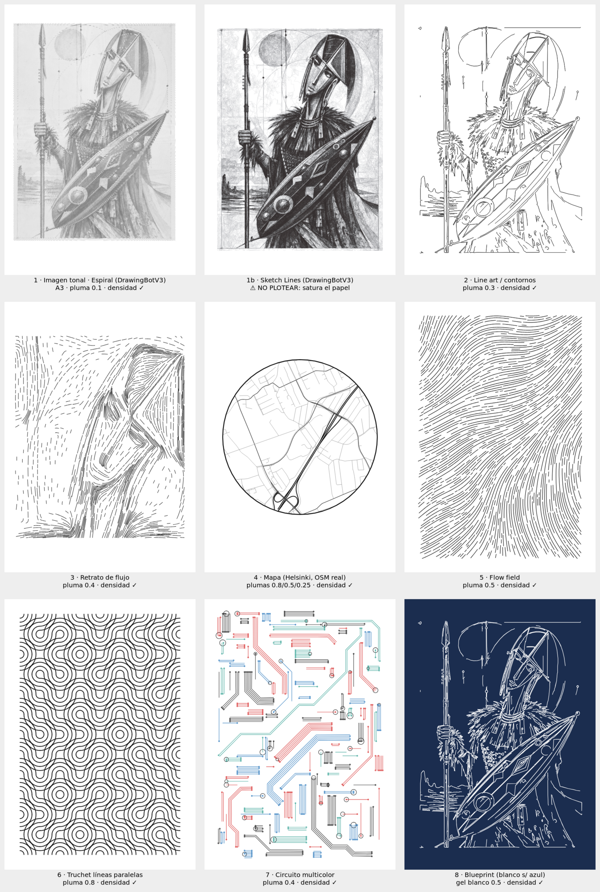

# Sistema de arte con plotter (NextDraw)

Recetas paso a paso para pasar de una idea a un dibujo físico con un **Bantam Tools NextDraw**
(8511 / 1117 / 2234). Todo el flujo trabaja en **SVG**, que es lo que usa el NextDraw (no G-code).


*Un ejemplo de cada estilo, generado con estos scripts*

## El flujo universal (todos los proyectos)

```
1. IDEA        → elegir estilo (tabla abajo) + papel + plumas
2. FUENTE      → imagen / datos de mapa / parámetros generativos
3. GENERAR     → script del estilo  → archivo.svg
4. PREPARAR    → ./preparar.sh archivo.svg a3 0.5   (papel + grosor de pluma: escala, optimiza y CONTROLA LA TINTA)
5. REVISAR     → abrir *_plot.svg (Inkscape / NextDraw app), ver tiempo estimado y metros de tinta
6. PLOTEAR     → prueba pequeña en papel barato → plot final, una capa (= pluma) cada vez
7. ARCHIVAR    → guardar SVG + parámetros + semilla + foto del resultado en proyectos/
```

## Estilos

| # | Estilo | Referencia visual | Script | Guía |
|---|---|---|---|---|
| 1 | Imagen → trazos tonales (sketch, espiral) | el guerrero | `tools/vectorize.sh` (DrawingBotV3) | [01](docs/01-imagen-a-trazos.md) |
| 2 | Imagen → line art / contornos | ilustraciones, logos | `estilos/lineart.py` | [01](docs/01-imagen-a-trazos.md) |
| 3 | Retrato de flujo (guiones que siguen la forma) | cara de Václav Zahrádka | `estilos/retrato_flujo.py` | [02](docs/02-retrato-flujo.md) |
| 4 | Mapas geográficos | mapa del maratón | `estilos/mapa.py` | [03](docs/03-mapas.md) |
| 5 | Flow fields / trazos orgánicos | lienzo de florianmarkus | `estilos/flowfield.py` | [04](docs/04-flow-fields.md) |
| 6 | Patrones de líneas paralelas (truchet) | pluma gruesa de Václav | `estilos/truchet.py` | [05](docs/05-patrones-truchet.md) |
| 7 | Multicolor / circuitos | Lostpixels | `estilos/circuito.py` | [06](docs/06-multicolor-circuitos.md) |
| 8 | Planos técnicos / blueprint (pluma blanca en papel oscuro) | A380 de Orowan Studio | SVG/DXF existente + `preparar.sh` | [07](docs/07-blueprint-svg-existente.md) |

Antes de nada lee la **[Guía completa](GUIA-COMPLETA.md)** (cómo funciona la máquina, iPad vs PC, software, plumas) y **[00 — Equipo, materiales y flujo](docs/00-equipo-y-flujo.md)**.

## Instalación (una vez)

```bash
python3 -m venv .venv && . .venv/bin/activate
pip install -r plotter/requirements.txt
tools/setup.sh                # solo si vas a usar DrawingBotV3 (estilo 1)
```
Software del plotter: instala **Bantam Tools NextDraw** (app + extensión de Inkscape) desde la web de Bantam Tools.
