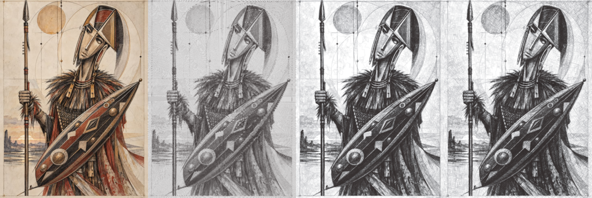

# 01 — Imagen → vectores (trazos tonales y line art)

Hay dos maneras de convertir una imagen para el plotter. Elige según la imagen:

| Si la imagen… | Usa | Resultado |
|---|---|---|
| tiene sombras, degradados, es una foto o una pintura | **Trazos tonales** (DrawingBotV3) | El tono se construye con densidad de líneas |
| tiene contornos claros (ilustración, cómic, logo) | **Line art** (`lineart.py`) | Solo los contornos, como un dibujo a tinta |


*Original · Spiral · Sketch Lines · Sketch Squares*

## A. Trazos tonales con DrawingBotV3

1. **Prepara la imagen**: recorta (quita bordes de capturas de pantalla), sube el contraste, ~1200–2000 px de lado.
   ```bash
   convert captura.png -fuzz 8% -trim +repage -resize 1600x input/obra.png
   ```
2. **Genera** (prueba los 3 algoritmos):
   ```bash
   tools/vectorize.sh input/obra.png output/obra_lines "Sketch Lines PFM"  svg,png
   tools/vectorize.sh input/obra.png output/obra_spiral "Spiral PFM"       svg,png
   tools/vectorize.sh input/obra.png output/obra_sq "Sketch Squares PFM"   svg,png
   ```
3. **Mira los PNG** y elige.
   - *Sketch Lines*: el más fiel. Genera varias capas de gris (una pluma por tono, o todas en negro).
   - *Spiral*: una sola línea continua: rapidísimo de plotear y muy gráfico.
   - *Sketch Squares*: textura geométrica.
4. **Prepara y plotea**: `plotter/preparar.sh output/obra_lines/obra.svg a3`
5. Para controlar todos los parámetros (densidad, largo de línea, plumas) abre DrawingBotV3 con interfaz en tu ordenador:
   descarga la versión Free desde su GitHub, carga la imagen, ajusta y exporta SVG.

## B. Line art / contornos

```bash
cd plotter/estilos
python lineart.py ../../input/obra.png -o obra_lineas.svg --papel A4 --detalle 2
```
- `--detalle 1..5`: más alto = más líneas (empieza en 2).
- `--min-largo 12`: sube a 30+ para quitar puntitos y ruido.
- Para un look *blueprint*: plotea con pluma blanca sobre papel azul o negro (ver guía 07).

**Truco:** combina A y B en dos capas: contornos en negro 0.5 y trazos tonales en gris 0.1 debajo.
