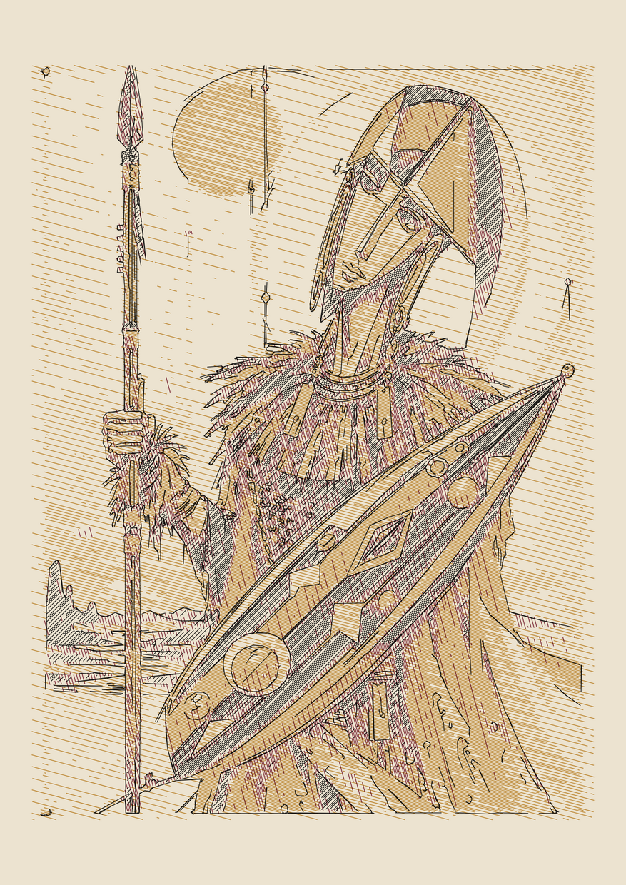

# 08 — Imagen a varios colores (elección automática de plumas)

Compartes una imagen y el sistema **elige de tu catálogo de plumas la combinación que mejor la reproduce**,
y genera una capa por pluma (tramas a distintos ángulos que se mezclan ópticamente), con contornos opcionales.


*Guerrero en A3 sobre papel crema: ocre + burdeos + negro (0.3), con contornos. Densidad ✓*

## 1. Tu catálogo de plumas: `plotter/plumas.json`

Catálogo de **123 plumas** (Micron, Staedtler, Stabilo, Uni, Copic, Pitt, Signo, Gelly Roll, G2, EnerGel, Posca,
Sharpie, pinceles y estilográficas). Cada una tiene `"tengo": true/false`: dime cuáles compras y las marco.
- Las **opacas** (blanco, metálicos, Posca) no entran en la mezcla automática: cubren en vez de mezclarse.
- Los **pinceles** quedan fuera del tramado por defecto (trazo variable); `--tipos` lo cambia.
- Plumas del **mismo color** (Micron negro, Uni Pin negro…) se tratan como una: el informe te dice cuáles son equivalentes.
Los colores que trae son aproximados.
**Para máxima fidelidad**: traza un cuadrado relleno con cada pluma, fotografíalo con luz de día, mide el color
(cualquier app de cuentagotas) y ponlo en el catálogo. También el color del **papel** (`"papel"`).

## 2. Elegir plumas (informe)

```bash
python plotter/estilos/colores.py foto.jpg --color-papel "#ece3d0" --solo-elegir --max 5
```
```
  1 plumas: ΔE 19.6  Micron burdeos
  2 plumas: ΔE 16.6  Micron negro + Micron marron
  3 plumas: ΔE 15.7  Micron burdeos + Micron negro + Staedtler ocre
  4 plumas: ΔE 15.2  Micron rojo + Micron sepia + Staedtler ocre + Micron negro
```
**ΔE** = diferencia de color media con el original (< 5 muy fiel · 5–10 bien · > 15 se aleja).
Fíjate en cuánto mejora cada pluma extra: si mejora < 1, no merece el trabajo de otra capa.
Las que no tienes salen marcadas "(no la tienes)": compara con `--solo-mias` para saber si vale la pena comprar.

## 3. Generar

```bash
python plotter/estilos/colores.py foto.jpg -o obra.svg --papel A3 --plumas 3 --color-papel "#ece3d0" --contornos 2
plotter/preparar.sh obra.svg a3 0.3,0.3,0.3          # grosores en el orden que imprime el script
```

| Opción | Efecto |
|---|---|
| `--plumas N` | número de plumas |
| `--usar "Micron negro 0.3"` | obliga a incluir esa pluma (repetible) |
| `--solo-mias` | elige solo entre las plumas que tienes (`"tengo": true`) |
| `--grosor 0.3` | grosor preferido cuando una pluma existe en varios |
| `--tipos fineliner,gel,...` | tipos de pluma candidatos |
| `--color-papel #hex` | color del papel (crema, kraft, gris…): **cambia mucho la fidelidad** |
| `--contornos 1-5` | añade contornos con la pluma más oscura: devuelve el detalle (ideal en ilustraciones) |
| `--cobertura-max 0.45` / `--tinta-total 0.55` | límites de tinta por capa y total (los valida `preparar.sh`) |
| `--sin-compresion` | no comprimir tonos (los oscuros se aplanan) |

Genera también `obra_simulacion.png`: original a la izquierda, simulación de la mezcla de tintas a la derecha.

## 4. Lo que hay que saber (física del plotter)

- Con plumas finas y sin empapar el papel, **una zona nunca puede ser más oscura que ~45–55 % de tinta**.
  Por eso el sistema **comprime los tonos** de la imagen a lo que se puede plotear: se conserva el contraste relativo,
  pero los negros profundos no existen. Fidelidad máxima ≠ copia exacta.
- **El papel de color es tu mejor aliado**: si la imagen tiene fondo beige, usa papel crema; el guerrero pasó de ΔE 22 (blanco) a 15.7 (crema).
- **Plotea de claro a oscuro** (el orden de capas ya viene así) y no muevas el papel entre plumas.
- Las capas se cruzan en ángulos distintos para que la mezcla sea uniforme y no salgan moarés.
