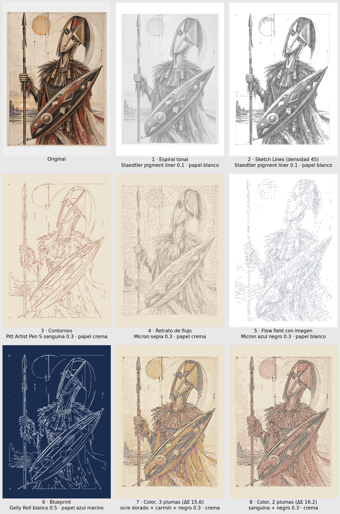

# El guerrero en todos los estilos (A3)

Todos pasan el control de densidad de tinta (`preparar.sh`). Los `*_plot.svg` están listos para el NextDraw.

| # | Archivo | Estilo | Pluma(s) | Papel |
|---|---|---|---|---|
| 1 | `01_espiral_plot.svg` | Espiral tonal (DrawingBotV3) | Staedtler pigment liner negro 0.1 | blanco |
| 2 | `02_sketch_plot.svg` | Sketch Lines, `Line Density=45` | Staedtler pigment liner negro 0.1 | blanco |
| 3 | `03_contornos_plot.svg` | Contornos (line art, detalle 2) | Pitt Artist Pen S sanguina 0.3 | crema |
| 4 | `04_flujo_plot.svg` | Retrato de flujo | Micron sepia 0.3 | crema |
| 5 | `05_flowfield_plot.svg` | Flow field guiado por la imagen | Micron azul negro 0.3 | blanco |
| 6 | `06_blueprint_plot.svg` | Blueprint (contornos) | Gelly Roll blanco 0.5 | azul marino |
| 7 | `07_color3_plot.svg` | Color, 3 plumas + contornos | 1 Pitt ocre dorado · 2 Staedtler triplus carmín · 3 negro (Micron/Copic), todas 0.3 | crema |
| 8 | `08_color2_plot.svg` | Color, 2 plumas + contornos | 1 Pitt sanguina · 2 negro, 0.3 | crema |

En 7 y 8 plotea en el orden de las capas (de claro a oscuro) sin mover el papel.
Truchet, circuito y mapas no salen de una imagen, por eso no están aquí.
